  
  
  
  

## ⚡ About

Computer Science & AI student seeking a **Software Engineering / AI Development** role. Full-stack developer (React, Next.js, Node.js, PostgreSQL) who has shipped a deployed event platform with authentication, role-based access and QR ticketing, and who applies Python data mining and machine learning to real datasets.

🎓 **B.Sc. Computer Science & Artificial Intelligence (AI Major)**, Pharos University in Alexandria. Expected graduation 2028
🗣️ Arabic (Native) · English (B2)

**[🚀 EventHub (live)](https://eventhub-i5pg.vercel.app)** · **[📂 More on GitHub](https://github.com/Youssef-Ahmed-Mohmed)**

## 🏆 Leadership & Certifications

- **Treasurer**, IEEE PUA Student Branch: financial coordination and budgeting for student activities
- **SSCS Arduino Contest Ambassador**, IEEE Egypt SSCS Chapter
- **Vice Head of Media Committee**, Dream Team: photo/video coverage of university events and AI exhibitions
- **Certifications:** Generative AI Certification (GAIC), Sprints & IOM Egypt · AI Workflow: Business Priorities and Data Ingestion, IBM · IEEE Member · IEEE Computer Society 80th Anniversary Member
